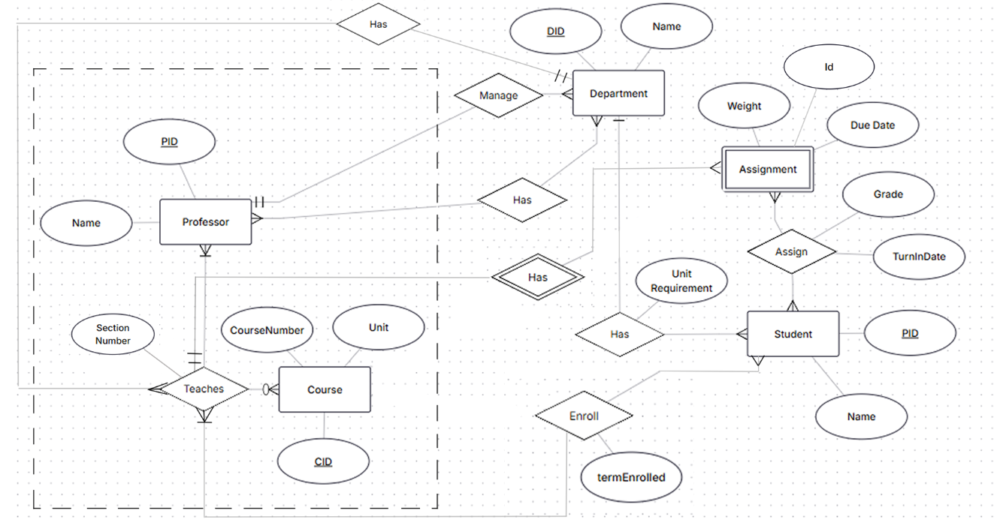

# CS166 Project - Grade Database

[Download the submission ZIP](output/CS166_Phase1.zip).

- [Combined report with screenshots](output/CS166_Phase1/Phase1_Report.pdf)
- [Teammate ER diagram](output/CS166_Phase1/ER_Diagram.pdf)
- [Create tables](sql/create_tables.sql)
- [Sample data](sql/sample_data.sql)

The report combines requirements, relational schema, and testing notes.
The ER diagram uses the original teammate image as-is.

## Run

With PostgreSQL running, from the project folder:

```sh
createdb cs166_project
psql -X -v ON_ERROR_STOP=1 -d cs166_project -f sql/load.sql
psql -X -v ON_ERROR_STOP=1 -d cs166_project -f sql/test_constraints.sql
psql -X -v ON_ERROR_STOP=1 -d cs166_project -f sql/queries.sql
```

Use an empty database or another name. Tests roll back their changes.
The ZIP has its own commands for the files inside it.

## Original ER diagram


